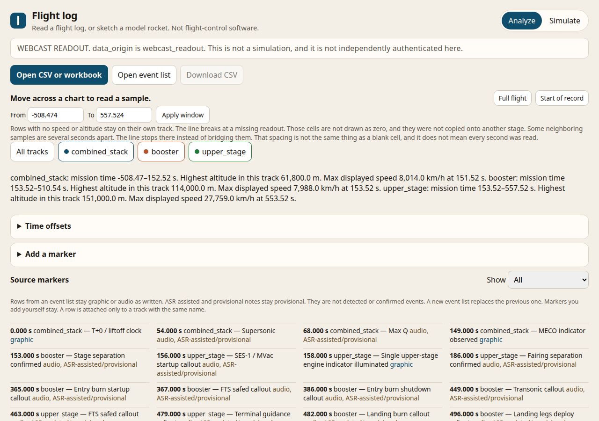
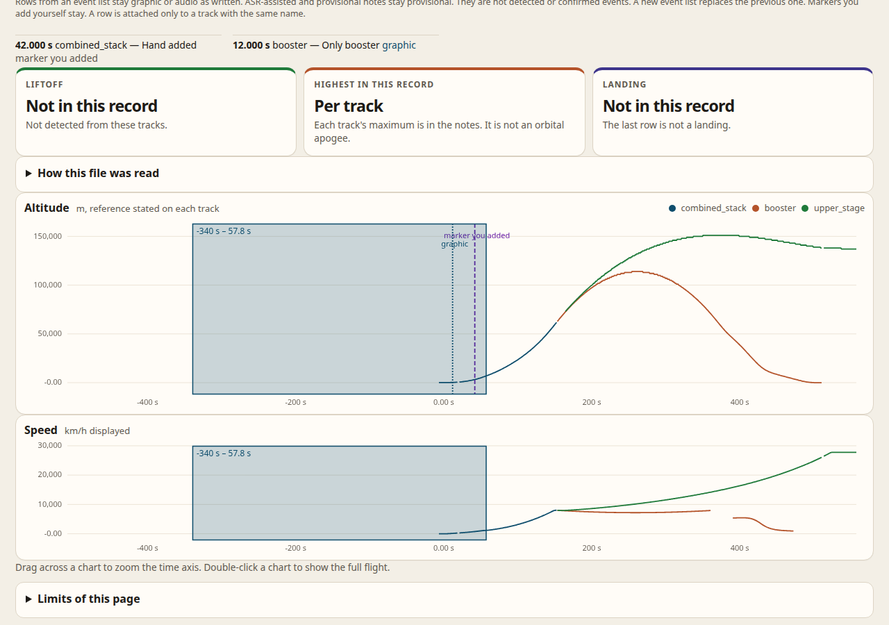

# Flight log

Open a flight or telemetry file and look at it. The page takes CSV and Excel workbooks, draws altitude and speed, and keeps stage tracks and event lists apart.

The live page is [telemetry-vizualizer.pages.dev](https://telemetry-vizualizer.pages.dev/). The first visit downloads a Python runtime into your browser. Files you open stay in that tab.

This is a reader and a small model-rocket sketch. It is not certified flight software, and it does not claim to read every logger.

## Open one of the demos

On the live page, under **Open a flight log**, choose a practice file:

- **Starlink 15-18** is the dense webcast file. It includes a long countdown before the numbers start.
- **Starlink Mission 2026-10-27** and **Starlink Mission 2026-10-23** are shorter webcast files from Vandenberg. The posts are titled only “Starlink Mission.” Group numbers and the exact liftoff clock are not verified.
- **Partial workbook** is one sheet of a short speed and altitude table.

Press **Import** when the column list looks right. Leave **Shift times so the first sample is 0 s** off if the file is already in mission time. Leave the model-rocket check off for these files.

The window starts at the whole file. Starlink 15-18 runs from about −508 s through 557 s. **Full flight** returns to that span after you zoom. **Start of record** is only the beginning.

## Open your own file

**Open CSV or workbook**, then match each column.

- A unit is filled in only when the header already names it, such as `altitude_km` or `t_ms`. A bare name such as `altitude` waits for you to choose meters, kilometers, or feet.
- Choose an altitude reference. **Unknown — do not assume** leaves the numbers as written. Above sea level asks for the launch-site elevation and subtracts it.
- Speed asks whether the column is total speed, vertical speed, or unknown. Unknown is not treated as vertical speed.
- `mission_time_s` stays the chart axis. `video_time_s` is stored and is not the axis.
- A **Stage or vehicle** column splits the file into tracks. Each name becomes its own track. Rows are not copied onto another stage.
- Blank cells stay missing. They are not stored as zero, and they are not a reason to drop the row. A displayed `0` stays zero.
- The line joins samples about a second apart. A wider gap is left open. That spacing is not the same thing as a blank cell.

If a flight is already open, importing another file replaces it. Check **Add these tracks beside the flight already open** only when you mean to compare them.

**Open event list** reads a CSV with `mission_time_s` and `event`. Optional columns are `vehicle`, `source`, and `notes`. A row is attached only to a track with the same name. It is not given to a different stage. Graphic rows stay graphic. Audio rows that say ASR or provisional stay provisional. They are not detected events. Opening another event list replaces the previous one. A marker you add yourself stays.

Drag across a chart to zoom. The band is the same on every visible chart. Release zooms to that interval. Double-click or **Full flight** shows the whole file again. **From** and **To** do the same thing if you type the times.

## What the numbers are

The Starlink files are webcast readouts: numbers read from a SpaceX broadcast, not a raw downlink, and not independently authenticated here. Altitude and speed references in those files are unknown. Some seconds were kept on purpose and others were left out; a 10 second step is not a claim that every second was checked. Extractor notes about unresolved digits are their review, not a check by this page.

The highest point in a file is the highest point in that record. It is not an orbital apogee. The last row is not a landing. No boostback call is added when the file does not have one. Dynamic pressure is not calculated. g-force and engine-icon counts are display extras, not throttle.

The model-rocket check, under **More import choices**, looks for liftoff, apogee, and landing on a short flight above the launch site. Leave it off for a webcast or a partial table.

## On your own computer

Install Python 3.11 or newer, then double-click `Launch Flight Log.bat` on Windows, or run `./launch_flightlog.sh` on macOS or Linux. The launcher does not install Python for you. Leave its window open while you use the page.

The folder `site/` is the same page with no build step.
